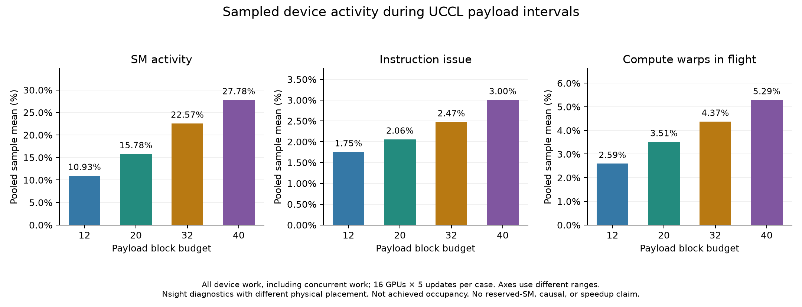

# Qwen EP-overlap measurement audit

All twelve full runs passed their per-case gates on the first attempt. Summary QA job 3911359 passed eight tests. Combined synthesis and independent numerical audit passed in job 3911397 on one debug node. The accepted output contains all 120 optimizer-step timers, 24 training/posthoc allocation records, 640 Torch captures and 320 hardware rank/update windows.

This campaign repeats the eight native/UCCL routing/profiler cases and four UCCL block budgets with the supported expert-parallel overlap bundle. Every full run starts independently from C0 and performs five warmup plus five measured optimizer updates. An optimizer update includes forward, backward, gradient accumulation, distributed gradients and the parameter update. Qualifications and failed attempts do not supply result samples.

## Configuration and input identity

The model is `Qwen/Qwen3-30B-A3B-Base`, revision `1b75feb79f60b8dc6c5bc769a898c206a1c6a4f9`, with 48 MoE layers. The workload keeps four GH200 nodes and 16 GPUs with EP16/CP1/TP1/PP1/ETP1. It uses BF16, sequence length 4096, MBS1, GBS64, GA4 and seed 1234. Ordinary routing selects the top eight of 128 experts. Grouped routing first selects two of four groups, then the top eight experts. Grouped expert GEMM remains enabled in every case.

| Control | New value and meaning |
| --- | --- |
| `model.overlap_moe_expert_parallel_comm` | `true`, use the native combined forward/backward schedule. |
| `model.delay_wgrad_compute` | `true`, delay weight-gradient computation. |
| `ddp.delay_wgrad_compute` | `true`, attach native gradient accumulation/reduction hooks to delayed weight gradients. All 16 actual wrappers must agree. |
| `model.ep_overlap_early_attn_memory_release` | `true`, release supported attention memory earlier. |
| `CUDA_DEVICE_MAX_CONNECTIONS` | `32`, set inside each worker before Torch imports. |
| `overlap_dispatch_backward_with_experts_wgrad` | `false`, the separate incompatible overlap mode remains disabled. |
| `moe_shared_expert_overlap`, `moe_shortcut_parallel` | Both `false`. This Qwen model has no shared expert. |
| `comm_overlap` | `None`. Native dense-DP gradient-reduction and parameter-gather overlap remain enabled. |

With `comm_overlap=None`, Bridge does not copy the model delay flag into DDP. The explicit DDP companion is therefore part of the required bundle. The comparison changes this complete bundle, including CUDA connections, rather than isolating one flag. Recomputation, CUDA graphs, FP8/FP4 and the original precision/fusion choices remain unchanged. The original [configuration audit](QWEN_UCCL_EXPERIMENT_AUDIT.md) describes the common workload, including effective scheduled weight decay 0.033.

| Bound input or source | Identity |
| --- | --- |
| C0 manifest | `27edfbc3ff917890e34fbad5f91fab9e79312c7adbb91829e0fcd18eb2244eba` |
| Dataset manifest | `03a0edd8e04dbc4083cc408b8268b5d6cada7fb3cd1f21ba872be7ea17bdbed7` |
| Common historical runtime-source subset | `409c26f60171efc0ea54aba24d9a544fc1a3a0672b4556b3ab69edee76def400` |
| Frozen new acquisition inventory | `ed74f4058652bb6f96dfa0496f70f7a888a150a2b2ee639df2d7edd499c8620a`, 144 files. |
| Summary inventory | `470a76adb3287a4669d1d9824e1bc38f5cee0aaa3a7a21010af85d30df1ce8dd`, 149 files, allocated QA job 3911359 passed eight tests. |

The container, framework revisions and recorded dirty-source identities match the inspected original records. UCCL retains the approved native build and scratch-ownership patch. UCCL uses its normal Buffer with CXI and `FI_MR_CACHE_MONITOR=disabled`. The eight-case matrix uses payload budget 20. The separate Nsight sweep uses 12/20/32/40.

Each full case records 640 actual CPU batches, `16 ranks × 10 updates × 4 microbatches`. The unchanged 25-update/1600-sample cache supplies the first 640 samples. Historical C0/data verification is explicitly reused, not repeated as fresh payload verification. Per-case proofs bind the observed input prefix. Combined validation and the independent audit confirm all twelve full cases match the original ten-update prefix, SHA-256 `6ce98c488cce7b047566c233fe93567d3d49905432e9b1709d6b07a4fd0514cb`.

Per-case acceptance requires finite training-health values and no skipped or NaN update. Expert counts, rank traffic and local/intra-node/inter-node assignments must reconcile to routed tokens times top8. Received assignments must agree with actual expert ownership. Source, input, rank-to-node placement and all-rank startup/completion records bind each proof to its executed case.

## Complete optimizer-step timing

These values are means of updates 6–10, in seconds. OFF disables the PyTorch profiler but retains routing, receive, input-fingerprint and training-health records. OFF is the primary timing evidence for this measured workload. It is not observer-free production training. The original values come from the accepted [old case proofs](../runs/qwen-debug-results-20261105T0925Z-cpu-validation/cases/). The new values come from the accepted cases in the [new ledger](../runs/ep-overlap-auto-retry-20261110T165819Z-retry-coordinator/accepted.tsv).

| Backend and routing | Original EP overlap disabled, profiler OFF | New EP overlap enabled, profiler OFF |
| --- | ---: | ---: |
| Native ordinary | 64.84364 | 62.46830 |
| Native grouped | 65.42208 | 65.57906 |
| UCCL ordinary | 15.55356 | 14.18634 |
| UCCL grouped | 9.85958 | 10.25018 |

Torch diagnostics include capture, stop and export costs. The observer now records the actual native schedule nodes rather than bypassed ordinary layer scopes. The table therefore describes instrumented elapsed time, not pure training throughput or isolated profiler overhead.

| Backend and routing | Original EP overlap disabled, Torch ON | New EP overlap enabled, Torch ON |
| --- | ---: | ---: |
| Native ordinary | 71.28104 | 72.97824 |
| Native grouped | 74.35522 | 75.18560 |
| UCCL ordinary | 30.49658 | 30.29198 |
| UCCL grouped | 25.00730 | 25.95784 |

Native updates near 65 seconds also occur in the original campaign. The new record does not establish a new large native regression. The [timing-path review](../ai/native-overlap-timing-review/iteration-01/REVIEW.md) found no new trace wrappers, Kineto capture or Nsight boundary in OFF. Native network-provider selection and tuning remain unproved. Separate allocations, physical placements, time and backend-specific audit work limit every contrast. Five sequential updates are not five independent experiment replicates.

## SM samples and actual GPU overlap

SM activity describes sampled device work during accepted communication payload intervals. The values include concurrent computation. The payload budget is a block count, not an SM reservation. A low mean does not count free SMs. Polling, waiting and memory work can keep a communication kernel alive with low instruction issue. These counters do not isolate that cause for a particular interval. The existing [SM communication review](../ai/qwen-sm-communication/iteration-01/STATUS.md) explains GPU, NIC and CPU-proxy roles in the pinned UCCL path.

| Payload blocks | SMs Active mean (%) | SM Issue mean (%) | Compute Warps in Flight mean (%) | Nsight updates 6–10 mean (s) | Metric record |
| ---: | ---: | ---: | ---: | ---: | --- |
| 12 | 10.93384 | 1.75426 | 2.59246 | 23.68084 | [metrics.json](../runs/ep-overlap-auto-retry-20261110T165819Z-uccl-ordinary-nsys12-attempt1-nsys-posthoc/metrics.json) |
| 20 | 15.78345 | 2.05667 | 3.51304 | 24.38606 | [metrics.json](../runs/ep-overlap-auto-retry-20261110T165819Z-uccl-ordinary-nsys20-attempt1-nsys-posthoc/metrics.json) |
| 32 | 22.56621 | 2.47456 | 4.37138 | 23.62240 | [metrics.json](../runs/ep-overlap-auto-retry-20261110T165819Z-uccl-ordinary-nsys32-attempt1-nsys-posthoc/metrics.json) |
| 40 | 27.78325 | 3.00419 | 5.28668 | 20.17420 | [metrics.json](../runs/ep-overlap-auto-retry-20261110T165819Z-uccl-ordinary-nsys40-attempt1-nsys-posthoc/metrics.json) |

Each accepted budget covers 80 rank/update windows and 61,440 known payload directions in four native Nsight reports. The pooled means weight individual samples, not rank means or quantiles. All four payload views report all 80 windows available. Other views must retain their own availability gates. Sampling periods can straddle kernel boundaries. Whole-session event completeness remains unresolved. Compute Warps in Flight is not achieved occupancy.

The chart below uses these overlap-enabled records. Its panels have different vertical scales. The [SVG](../runs/ep-overlap-summary-20261110-final-attempt1/hardware_budget_comparison.svg) is available for export.

The new Torch analyses contain 160 rank/update captures per case. Positive same-device intersections appear in 116/160 native ordinary, 107/160 native grouped, 160/160 UCCL ordinary and 160/160 UCCL grouped captures. These intersections link known payload launches to selected named GEMM/attention work. Native attribution covers forward payloads only. Compute without exact node ancestry remains outside the selection. The counts prove some actual concurrency, not complete compute coverage or exposed-latency savings.

## Boundary costs and whole-run time

Nsight captures updates 6–10. Its start API affects the first captured update and its stop API strongly affects the last. The table gives the maximum recorded API duration across 16 ranks, separate from synchronization and barrier fields. No API cost is subtracted from an optimizer timer.

| Payload blocks | Maximum start API (s) | Maximum stop API (s) |
| ---: | ---: | ---: |
| 12 | 2.68442 | 38.59043 |
| 20 | 2.60828 | 38.51952 |
| 32 | 2.61535 | 38.76934 |
| 40 | 2.59225 | 36.19725 |

The complete optimizer timer sum adds all ten printed update timers. Training allocation elapsed also includes setup, model construction, checkpoint loading, final capture work and small health summaries. It excludes queue waiting and the separate analysis allocation. Posthoc allocation elapsed describes analysis cost. These three quantities remain separate below. Times are seconds.

| Case | Training job | Training allocation (s) | Ten-step timer sum (s) | Posthoc job | Posthoc allocation (s) |
| --- | ---: | ---: | ---: | ---: | ---: |
| Native ordinary OFF | 3910268 | 857 | 650.4003 | 3910369 | 20 |
| Native ordinary Torch | 3910372 | 981 | 758.0483 | 3910466 | 778 |
| Native grouped OFF | 3910504 | 875 | 678.5626 | 3910586 | 23 |
| Native grouped Torch | 3910591 | 986 | 780.9098 | 3910693 | 818 |
| UCCL ordinary OFF | 3910769 | 381 | 175.8948 | 3910796 | 21 |
| UCCL ordinary Torch | 3910803 | 551 | 341.9536 | 3910839 | 1002 |
| UCCL grouped OFF | 3910905 | 351 | 140.8548 | 3910921 | 23 |
| UCCL grouped Torch | 3910924 | 512 | 294.9365 | 3910963 | 1077 |
| UCCL Nsight12 | 3911132 | 445 | 230.6384 | 3911220 | 246 |
| UCCL Nsight20 | 3911074 | 459 | 238.2756 | 3911120 | 243 |
| UCCL Nsight32 | 3911234 | 443 | 231.7481 | 3911278 | 242 |
| UCCL Nsight40 | 3911309 | 404 | 198.5548 | 3911355 | 228 |

All 24 allocations completed with exit code 0:0. Exact UTC start/end times and actual physical node placements are in the CSV files and [saved Slurm accounting](../runs/ep-overlap-summary-20261110-final-attempt1/evidence/accounting_utc.psv). Each training allocation used four debug nodes with a 21-minute limit; each separate posthoc allocation used one debug node with at most 90 minutes. The additional final aggregation job 3911397 ran on nid007584 from 2026-11-10T20:57:10Z to 20:58:53Z, 103 seconds. Its cost is separate from every case above.

The output root is `runs/ep-overlap-summary-20261110-final-attempt1`. The independent audit reconstructs timer statistics, checks separate allocation records, confirms the original input prefix, and independently checks hardware sample weighting. The [source and interpretation review](../ai/ep-overlap-summary-review/iteration-01/REVIEW.md) records its scope.

| Artifact | Content |
| --- | --- |
| [campaign_summary.json](../runs/ep-overlap-summary-20261110-final-attempt1/campaign_summary.json) | Exact twelve accepted cases, source/input bindings, placement, timing and metric limits. |
| [optimizer_steps.csv](../runs/ep-overlap-summary-20261110-final-attempt1/optimizer_steps.csv) | All 120 step timers, including 60 warmup and 60 measured updates. |
| [eight_cases.csv](../runs/ep-overlap-summary-20261110-final-attempt1/eight_cases.csv) | Eight-case statistics and separate training/posthoc allocation time. |
| [sm_budgets.csv](../runs/ep-overlap-summary-20261110-final-attempt1/sm_budgets.csv) | Four SM-budget means and separate allocation times. Availability flags remain in campaign_summary.json and the original metrics.json files. |
| [independent_numerical_audit.json](../runs/ep-overlap-summary-20261110-final-attempt1/independent_numerical_audit.json) | Independent reconstruction and arithmetic acceptance. |
| [input_references.json](../runs/ep-overlap-summary-20261110-final-attempt1/input_references.json) | Hash-bound raw evidence paths and archived small proofs. |

## Reproduction and acceptance limits

Start with the [measurement guide](../ai/qwen-debug-reproducibility/iteration-01/MEASUREMENTS.md) for the fixed model, C0, tokenizer, indexed mixture, cache, container and UCCL build. That guide describes the original overlap-OFF measurements. Apply the explicit bundle above for this new campaign. On another machine, prepare and establish those input/build identities before using the training launchers. Existing historical proofs and job IDs belong to this workspace.

The new [entrypoint](../profiling/run_pretrain_ep_overlap.py) preserves the 25-update cache and exits after 2 qualification or 10 full updates. `train_iters=25` preserves cache compatibility, while `exit_interval=10` ends a full run after ten real updates. The [preflight](../jobs/smoke/ep_overlap_preflight.sbatch) tests the runtime and observation contract on allocated compute. The [checked acquisition launcher](../jobs/training/ep_overlap_checked.sbatch) requests four debug nodes for 21 minutes. The [posthoc launcher](../jobs/analysis/ep_overlap_posthoc.sbatch) then uses one debug node for strict input, routing, health, lifecycle and mode-specific checks. The [summary launcher](../jobs/analysis/ep_overlap_campaign_summary.sbatch) runs new-source QA or full synthesis and the independent arithmetic audit.

The [summary execution commands](../ai/ep-overlap-campaign-summary/iteration-01/COMMANDS.md) describe the separate source-qualified QA and synthesis allocations. Acquisition QA job 3908134 passed 72 focused tests for the frozen 144-file source. Summary QA job 3911359 passed eight focused tests, source-closure checks, Python compilation and actual plotting imports for the 149-file summary inventory. The raw source archives and [summary input manifest](../runs/ep-overlap-summary-20261110-final-attempt1/input_references.sha256) retain the actual producers and evidence hashes.

The [accepted ledger](../runs/ep-overlap-auto-retry-20261110T165819Z-retry-coordinator/accepted.tsv) binds each training ID to its separate posthoc ID. The [acquisition ledger](../runs/ep-overlap-auto-retry-20261110T165819Z-retry-coordinator/acquisitions.tsv) preserves exact attempts and settings. The [retry coordinator](../jobs/coordination/ep_overlap_retry_campaign.sh) is a continuation for this recorded campaign and retains existing qualified proofs. Fresh reproduction needs fresh qualifications and unique run IDs. Root checks the full user queue before every submission. At most four nodes are requested across the campaign. Analysis and runtime commands run only on allocated compute in the configured container.

Four two-update qualifications precede the full matrix. Pilot 3907973 remains rejected because model delay was true while actual DDP delay was false. Failed 3909844 stopped before training after a Git-metadata timeout. Fresh 3910146 supplies the successful replacement qualification. These records do not count toward the twelve full results. Summary QA job 3911281 remains preserved after a missing source-inventory dependency. Corrected QA job 3911359 added the unchanged conditional-import helper to the inventory and passed. No mock training ran, and no full acquisition was repeated.

The measurements do not identify a production-optimal block budget, isolated causal overlap speedup, physical wire traffic, instantaneous active/free SM count or achieved occupancy. Only budget 20 has an unprofiled timing control in this new matrix. CPU scopes, logical assignments, GPU interval unions/intersections and optimizer wall time are distinct quantities. Nested and concurrent intervals cannot be added into a step-time partition. The report supports descriptive comparisons under the recorded configurations, observers and placements.
